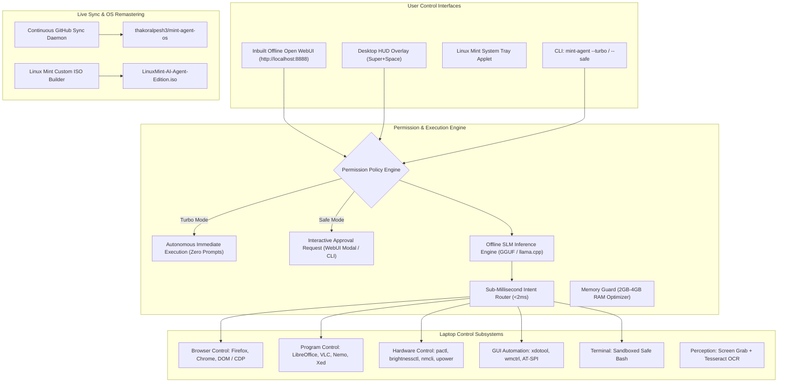

# 🍃 Linux Mint AI Agent Edition (MintPilot OS)

[](https://github.com/thakoralpesh3/mint-agent-os)
[](https://linuxmint.com/)
[](http://localhost:8888)
[](https://github.com/thakoralpesh3/mint-agent-os)
[](https://linuxmint.com/)

An autonomous, customized **Linux Mint Operating System** featuring:
1. **Inbuilt Offline Open WebUI Dashboard** (`http://127.0.0.1:8888`) with native OpenAI API endpoints (`/v1/chat/completions`).
2. **Dual Operational Execution Policies**:
   - ⚡ **Turbo Mode (Antigravity-Style)**: Unrestricted, end-to-end autonomous execution with zero permission prompts and automatic self-healing loops.
   - 🛡️ **Safe Mode**: Intercepts sensitive operations (shell commands, file modifications, browser actions, power states) and requests interactive user confirmation.
3. **Total Laptop & PC Control**: Controls hardware (volume, brightness, battery, Wi-Fi), manages desktop windows, moves mouse, types text, and inspects UI trees via AT-SPI.
4. **Deep Program Automation**: Controls desktop applications (LibreOffice Writer/Calc, VLC Media Player, Nemo File Manager, Text Editors, Terminal).
5. **Browser Control**: Works inside Firefox, Chrome, and Chromium (opens URLs, switches tabs, scrolls pages, extracts web text and links).
6. **Strict Linux Mint 2GB-4GB RAM Compatibility**: Features an ultra-lean memory footprint (<35MB RAM for WebUI + Agent) and quantized GGUF small language models.
7. **Continuous GitHub Conversation Sync**: Real-time background sync daemon that mirrors conversation transcripts and planning artifacts directly to GitHub.

---

## 🌟 System Architecture



---

## ⚡ 1. Turbo Mode vs Safe Mode (Antigravity-Style)

MintPilot features two distinct execution policies:

| Feature | ⚡ Turbo Mode (Autonomous) | 🛡️ Safe Mode (Permission Required) |
| :--- | :--- | :--- |
| **Philosophy** | Antigravity-style autonomous multi-step execution | Guarded execution with human-in-the-loop oversight |
| **Permission Prompts** | **None**. Executes commands and plans immediately | Prompts for approval before running modifying actions |
| **Sensitive Actions** | Auto-approved (bash scripts, browser clicks, file writes) | Triggers WebUI approval modal or CLI `[y/N]` prompt |
| **Self-Healing** | Automatically retries alternative paths on error | Notifies user and requests guidance on error |
| **How to Toggle** | Click toggle switch in WebUI or run `mint-agent --turbo` | Click toggle switch in WebUI or run `mint-agent --safe` |

---

## 🌐 2. Inbuilt Offline Open WebUI Dashboard

The embedded WebUI runs locally on **`http://127.0.0.1:8888`** and consumes less than **25MB RAM**:

- **Top Navigation Bar:**
  - Live execution mode switch (⚡ Turbo vs 🛡️ Safe).
  - Real-time RAM, CPU load, and Battery telemetry gauges.
  - "🧹 Free RAM" one-click memory housekeeping button.
- **Tab 1: 💬 Chat & Agent Telemetry:**
  - Conversational chat interface with streaming thoughts, tool execution cards, latency metrics, and quick action chips.
- **Tab 2: 🌐 Browser Controller:**
  - Visual URL navigation bar.
  - Controls: "New Tab", "Close Tab", "Scroll Down", "Extract Content", "Search Google".
  - Extracted web content inspector (readable text and links without heavy browser memory overhead).
- **Tab 3: 🖥️ Desktop Programs & PC:**
  - One-click launcher grid for LibreOffice Writer, Calc, VLC, Nemo, Terminal, Calculator.
  - Live active desktop windows panel with "Focus Window" buttons.
- **OpenAI-Compatible API:**
  - `GET /v1/models`
  - `POST /v1/chat/completions`  
  *(Allows external Open WebUI or third-party LLM clients to point directly to `http://localhost:8888/v1`)*

---

## 💻 3. Laptop, Program & Browser Capabilities

| Subsystem | Capabilities | Underlying Tooling |
| :--- | :--- | :--- |
| **🌐 Web Browsers** | Open URLs, new/close tabs, switch tabs, scroll, search Google, extract page text/links | Firefox, Chrome, `BrowserController` |
| **📝 Office Software** | Create documents in LibreOffice Writer, type text, save to disk, open spreadsheets in Calc | `libreoffice`, `ProgramController` |
| **🎬 Media Players** | Play, pause, toggle fullscreen, seek, and control VLC | `vlc`, `ProgramController` |
| **📁 File Management** | Open folders, browse files in Nemo file manager | `nemo`, `gio` |
| **🔊 Sound & Audio** | Set volume (0-150%), toggle mute/unmute, query volume | `pactl` / `amixer` |
| **💡 Display** | Set brightness (1-100%), query brightness | `brightnessctl` |
| **⚡ Power & Battery** | Battery telemetry, lock workstation, sleep, reboot, shutdown | `upower`, `systemctl`, `cinnamon-screensaver-command` |
| **📶 Wi-Fi & Network** | Scan nearby Wi-Fi, connect to SSID, airplane mode | `nmcli` |
| **🪟 GUI Windows** | List open windows, focus/switch window, close window, show desktop | `wmctrl`, `xdotool` |
| **🖱️ Mouse & Keyboard** | Move cursor, click, drag, type keystrokes, shortcuts (`Ctrl+C`, `Alt+Tab`) | `xdotool`, `pyautogui` |
| **🔍 AT-SPI Accessibility**| Inspect UI button names, inputs, and menus directly | `pyatspi` |
| **👁️ Screen Vision** | Screenshot capture + Optical Character Recognition | `maim`, `tesseract-ocr` |
| **💻 Safe Shell** | Sandboxed bash command execution with safety filters | `bash`, `subprocess` |

---

## 🧠 4. Strict Linux Mint PC Compatibility (2GB-4GB RAM)

MintPilot is tuned to meet and respect official Linux Mint system requirements:

- **Ultra-Lean Runtime:** WebUI and agent daemon consume **<35MB RAM** combined.
- **Hardware-Adaptive SLM Tiering:**
  - **Tier 1 (2GB - 4GB RAM):** `Qwen2.5-0.5B-Instruct` (~400MB RAM) or `Qwen2.5-Coder-1.5B-Q4_K_M` (~1.1GB RAM) via CPU-optimized GGUF.
  - **Tier 2 (8GB - 12GB RAM):** `Qwen2.5-3B-Instruct` or `Llama-3.2-3B`.
  - **Tier 3 (16GB+ RAM / GPU):** `Qwen2.5-7B-Instruct` or `Mistral-Nemo-12B`.
- **Memory Guard:** Monitored via `/proc/meminfo`. If available RAM drops below threshold, automatically triggers garbage collection and filesystem sync.

---

## 🚀 5. Quick Start: Testing on Your System

### 1. Launch the Inbuilt Open WebUI Dashboard:
```bash
python3 agent/webui/server.py 8888
# Open http://localhost:8888 in your browser!
```

### 2. Run CLI Commands with Permission Modes:
```bash
# Turbo Mode (Autonomous, no confirmation prompts)
python3 agent/cli.py --turbo "volume 50%"
python3 agent/cli.py --turbo "search web for Linux Mint"
python3 agent/cli.py --turbo "open nemo"

# Safe Mode (Asks confirmation for sensitive actions)
python3 agent/cli.py --safe "$ echo 'Testing Safe Mode'"

# Free RAM / Clean Caches
python3 agent/cli.py --clean-ram

# Display Hardware Tier & Memory Stats
python3 agent/cli.py --tier
```

### 3. Launch Floating HUD Overlay:
```bash
python3 agent/ui/hud_overlay.py
# (Summonable via Super + Space)
```

---

## 💿 6. Building the Custom Linux Mint OS ISO

To build the bootable Linux Mint OS ISO with MintPilot and Open WebUI pre-installed:

```bash
cd iso_builder
chmod +x *.sh

# Remaster official Linux Mint ISO into LinuxMint-AI-Agent-Edition.iso
./remaster_mint_iso.sh

# Test boot inside QEMU virtual machine
./test_qemu.sh

# Flash to physical USB drive
sudo dd if=LinuxMint-AI-Agent-Edition.iso of=/dev/sdX bs=4M status=progress conv=fsync
```

---

## 🔄 7. Continuous GitHub Conversation Auto-Sync

The background daemon ([`sync/sync_daemon.py`](file:///home/alpesh/mint-agent-os/sync/sync_daemon.py)) runs persistently in the background. Every conversation turn, plan, and code change is automatically formatted into [`conversation/CONVERSATION.md`](file:///home/alpesh/mint-agent-os/conversation/CONVERSATION.md) and pushed to [thakoralpesh3/mint-agent-os](https://github.com/thakoralpesh3/mint-agent-os).
