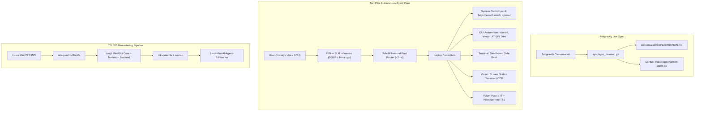

# 🍃 Linux Mint AI Agent Edition (MintPilot OS)

[](https://github.com/thakoralpesh3/mint-agent-os)
[](https://linuxmint.com/)
[](https://github.com/thakoralpesh3/mint-agent-os)
[](https://github.com/thakoralpesh3/mint-agent-os/tree/main/conversation)

An autonomous, customized **Linux Mint Operating System** with an **inbuilt offline AI agent (MintPilot)** engineered to completely control laptops without internet connectivity, alongside a continuous GitHub synchronization daemon that keeps conversation logs, artifacts, and codebase updates synchronized with GitHub.

---

## 🌟 Key Architecture & Capabilities



---

## 💻 1. Complete Laptop Control Suite

MintPilot possesses native access to laptop hardware and desktop interfaces:

| Subsystem | Capabilities | Underlying Tooling |
| :--- | :--- | :--- |
| **🔊 Audio & Sound** | Set volume (0-150%), mute/unmute, query volume | `pactl` / `amixer` |
| **💡 Display** | Set brightness (1-100%), query brightness | `brightnessctl` |
| **⚡ Power & Battery** | Battery %, charging state, time to empty, sleep, lock screen, reboot, shutdown | `upower`, `systemctl`, `cinnamon-screensaver-command` |
| **📶 Networking & Wi-Fi** | Scan Wi-Fi SSIDs, connect to network, airplane mode toggle | `nmcli` |
| **🪟 GUI Windows** | List open windows, switch/focus window, minimize all (show desktop), close window | `wmctrl`, `xdotool` |
| **🖱️ Mouse & Keyboard** | Move cursor, left/right/double click, drag, type text, key combos (`Ctrl+C`, `Alt+F4`, `Super+D`) | `xdotool`, `pyautogui` |
| **🔍 Accessibility (AT-SPI)**| Read UI button labels, textboxes, and menus directly without heavy vision models | `pyatspi` |
| **👁️ Screen Vision** | Screenshot capture, Optical Character Recognition (OCR) | `maim`, `tesseract-ocr` |
| **💻 Terminal & Shell** | Safe bash command execution with safety filters and auto-reflection | `bash`, `subprocess` |
| **🎙️ Offline Voice** | Speech-to-text and spoken audio replies 100% offline | `vosk`, `piper-tts`, `spd-say` |

---

## ⚡ 2. Dynamic Hardware-Adaptive Model Tiers

MintPilot automatically detects the host laptop's CPU, GPU, and RAM at boot:

- **Tier 1 (Ultra-Light - for 4GB RAM / Older CPUs like Haswell i3):**  
  Uses `Qwen2.5-0.5B-Instruct` (~400MB RAM) or `Qwen2.5-Coder-1.5B-Q4_K_M` (~1.1GB RAM) via CPU-quantized GGUF. Instant sub-millisecond fast intent routing ensures battery, volume, brightness, and app launches respond in `<2ms`.
- **Tier 2 (Balanced - for 8GB to 12GB RAM):**  
  Uses `Qwen2.5-3B-Instruct` or `Llama-3.2-3B`.
- **Tier 3 (High-End - for 16GB+ RAM / Dedicated GPU):**  
  Uses `Qwen2.5-7B-Instruct` or `Mistral-Nemo-12B`.

---

## 🚀 3. Quick Start: Testing MintPilot Right Now

You can run MintPilot immediately on your current Linux Mint system:

### Check Hardware Tier:
```bash
python3 agent/cli.py --tier
```

### Run Laptop Control Commands:
```bash
# Volume control
python3 agent/cli.py "volume 40%"

# Battery and power status
python3 agent/cli.py "battery"

# Scan nearby Wi-Fi networks
python3 agent/cli.py "scan wifi"

# Launch application
python3 agent/cli.py "open nemo"

# Interactive REPL session
python3 agent/cli.py -i
```

### Launch Floating HUD Overlay:
```bash
python3 agent/ui/hud_overlay.py
```
*(Press `Super + Space` when installed in the OS)*

---

## 💿 4. Building the Custom Linux Mint OS ISO

To build a standalone bootable USB / ISO for any laptop:

```bash
cd iso_builder
chmod +x *.sh

# Remasters official Linux Mint ISO into LinuxMint-AI-Agent-Edition.iso
./remaster_mint_iso.sh

# Test boot inside QEMU virtual machine
./test_qemu.sh
```

---

## 🔄 5. Continuous GitHub Conversation Auto-Sync

This repository automatically syncs with this active Antigravity session.

- **Conversation Transcript:** Stored in [`conversation/CONVERSATION.md`](file:///home/alpesh/mint-agent-os/conversation/CONVERSATION.md) and [`conversation/transcript.jsonl`](file:///home/alpesh/mint-agent-os/conversation/transcript.jsonl).
- **Artifacts:** Synced in [`artifacts/`](file:///home/alpesh/mint-agent-os/artifacts/).
- **Manual Sync Command:**
  ```bash
  ./sync_to_github.sh
  ```
- **Background Daemon:** Runs as a systemd service (`sync/mint-agent-sync.service`) to push updates to GitHub in real time.
