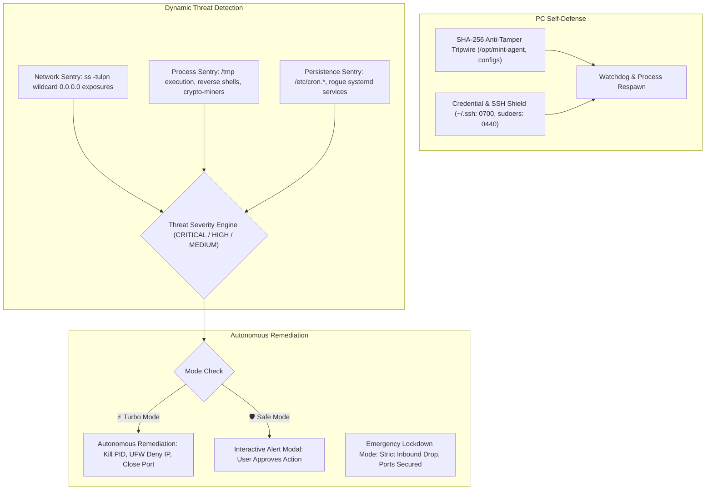

# 🍃 Linux Mint AI Agent Edition (MintPilot OS)

[](https://github.com/thakoralpesh3/mint-agent-os)
[](https://thakoralpesh3.github.io/mint-agent-os/)
[](https://github.com/thakoralpesh3/mint-agent-os)
[](https://linuxmint.com/)
[](http://localhost:8888)
[](https://github.com/thakoralpesh3/mint-agent-os)
[](https://linuxmint.com/)

An autonomous, customized **Linux Mint Operating System** equipped with **MintPilot** — an inbuilt offline AI agent acting as both a **total laptop controller** and an autonomous **Cybersecurity Guardian & PC Defense System**, paired with an embedded **Open WebUI** and a **24/7 online interactive desktop simulator** hosted live on GitHub!

---

## 💾 1. Download MintPilot Agent OS & Make Bootable USB

Get the full operating system ISO image or flash it directly to a USB drive to boot on any physical laptop or PC.

[-87cf3e?style=for-the-badge&logo=linuxmint)](https://github.com/thakoralpesh3/mint-agent-os/releases/latest)
[](https://github.com/thakoralpesh3/mint-agent-os#option-a-automated-linux-terminal-flasher-safest--easiest)
[](https://github.com/thakoralpesh3/mint-agent-os#option-b-ventoy-drag--drop-iso-recommended-for-all-users)

### 📥 Download Options:
1. **Direct Live Bootable ISO Image**:
   - **[Download LinuxMint-AI-Agent-Edition.iso (GitHub Releases)](https://github.com/thakoralpesh3/mint-agent-os/releases/latest)**
   - Base: **Linux Mint 22.3 (Zena) 64-bit Cinnamon**
   - Architecture: **x86_64** (UEFI & Legacy BIOS bootable)
   - Pre-installed: MintPilot Daemon, Open WebUI, Offline Qwen SLM, Cyber Guardian & DEFCON Matrix
2. **In-Place Upgrade (Convert existing Linux Mint without USB or reformatting)**:
   ```bash
   curl -sSL https://raw.githubusercontent.com/thakoralpesh3/mint-agent-os/main/upgrade_mint_to_agent_os.sh | sudo bash
   ```

---

### ⚡ 4 Ways to Make a Bootable USB Drive:

#### Option A: Automated Linux Terminal Flasher (Safest & Easiest)
We provide an interactive script in the repository that automatically detects your USB drive, protects your internal system disk from accidental erasure, and writes the bootable ISO:

```bash
# Clone repository or navigate to directory:
git clone https://github.com/thakoralpesh3/mint-agent-os.git
cd mint-agent-os

# Run the automated bootable USB creator:
sudo ./make_bootable_usb.sh
```

#### Option B: Ventoy (Drag & Drop ISO — Recommended for All Users)
Ventoy is the easiest way to make a multi-boot USB on Windows, macOS, or Linux without wiping your drive every time:
1. Download and install **[Ventoy](https://www.ventoy.net/en/download.html)** onto your USB flash drive (8GB+ recommended).
2. Download `LinuxMint-AI-Agent-Edition.iso` from [GitHub Releases](https://github.com/thakoralpesh3/mint-agent-os/releases/latest).
3. Simply **copy and paste the `.iso` file directly into your USB drive folder** in File Explorer / Nemo / Finder.
4. Plug the USB into any laptop and power on. Ventoy will boot and display MintPilot Agent OS in the boot menu!

#### Option C: Graphical Flashers (BalenaEtcher / Rufus / Raspberry Pi Imager)
Works on Windows, Mac, and Linux:
1. Download **[BalenaEtcher](https://etcher.balena.io/)** or **[Rufus](https://rufus.ie/)** (for Windows).
2. Select the downloaded `LinuxMint-AI-Agent-Edition.iso`.
3. Select your USB drive as the target.
4. Click **Flash / Start** and wait for completion.

#### Option D: Native Linux Command Line (`dd`)
```bash
# 1. Identify your USB drive (e.g., sdb, sdc - DO NOT use your OS drive!):
lsblk

# 2. Unmount any active partitions on the USB:
sudo umount /dev/sdX*

# 3. Flash the ISO (replace /dev/sdX with your USB drive):
sudo dd if=LinuxMint-AI-Agent-Edition.iso of=/dev/sdX bs=4M status=progress conv=fdatasync
```

---

### 💻 How to Boot from USB on Any PC / Laptop:
1. Plug the USB into a USB 3.0 / USB-C port while the PC is turned off.
2. Power on the PC and immediately press the **Boot Menu Key** repeatedly:
   - **Lenovo / ThinkPad:** `F12` (or `Fn + F12`)
   - **Dell / Alienware:** `F12`
   - **HP / Pavilion / Omen:** `F9` or `Esc`
   - **Asus / ROG:** `F8`, `Del`, or `Esc`
   - **Acer / Predator:** `F12`
   - **MSI:** `F11`
   - **Apple Mac (Intel):** Hold `Option / Alt` at startup
3. Select your USB drive from the menu and press `Enter`.
4. The system will boot into the **MintPilot Agent OS Live Environment** with full offline AI laptop control and cyber defense ready!

---

## 🌐 2. Try the 24/7 Online OS Simulator Now!

Experience the Linux Mint AI Agent OS & Cyber Defense Guardian directly in your browser:

👉 **[Launch Online 24/7 Linux Mint OS Simulator](https://thakoralpesh3.github.io/mint-agent-os/)**

### Interactive Features Online:
- **Cinnamon 22.3 Desktop**: Drag, resize, maximize, and stack windows.
- **🛡️ Cyber Defense Guardian Window**: View live Cybersecurity Hardening Score (92/100), active UFW firewall shield, anti-tamper tripwire, and 1-click threat scan.
- **🍃 MintPilot Open WebUI Window**: Chat with the agent, toggle **⚡ Turbo vs 🛡️ Safe Mode**, and monitor live RAM/CPU gauges.
- **💻 Functional Bash Terminal**: Test commands (`mint-agent --security`, `mint-agent --scan-threats`, `mint-agent --lockdown`, `neofetch`, `free -h`).
- **🦊 Firefox & 📁 Nemo Files**: Simulated web browsing and directory exploration.
- **Floating HUD Overlay**: Press **`Super + Space`** to trigger the command bar.

---

## 🛡️ 2. PC Self-Defense & Autonomous Threat Protection

MintPilot protects the computer against malware, unauthorized intrusions, network exposures, and process hijacking:



### Key Defensive Capabilities:
1. **Cryptographic Anti-Tamper Tripwire ([`self_defense.py`](file:///home/alpesh/mint-agent-os/agent/security/self_defense.py))**:
   - Computes SHA-256 checksums of core binaries, config files, and systemd services.
   - Detects if an unauthorized user or malware modifies agent files or root configurations.
   - Enforces strict permissions on `~/.ssh/` (0700/0600) and `/etc/sudoers.d/` (0440).
2. **Dynamic Threat Detection ([`threat_detector.py`](file:///home/alpesh/mint-agent-os/agent/security/threat_detector.py))**:
   - **Network Sentry**: Scans all active listening sockets; flags insecure wildcard `0.0.0.0` bindings.
   - **Process & Anomaly Sentry**: Identifies binaries executing from `/tmp` or `/dev/shm`, crypto-miners, and hidden reverse shells (`bash -i >& /dev/tcp/`).
   - **Persistence Sentry**: Monitors `/etc/cron.*`, crontabs, and new systemd units.
3. **Automated Defensive Remediation ([`remediation.py`](file:///home/alpesh/mint-agent-os/agent/security/remediation.py))**:
   - **In Turbo Mode**: Neutralizes threats autonomously (force-kills malicious processes, blocks hostile IPs via UFW firewall).
   - **In Safe Mode**: Alerts the user with threat severity and a 1-click "Approve Neutralization" button.
   - **Emergency Lockdown Mode**: Enforces strict default-deny incoming firewall policy and isolates external ports.
   - **Security Score (0–100)**: Evaluates hardening based on CIS Linux & SAIF benchmarks.

---

## ⚡ 3. Turbo Mode vs Safe Mode (Antigravity-Style)

| Feature | ⚡ Turbo Mode (Autonomous) | 🛡️ Safe Mode (Guarded) |
| :--- | :--- | :--- |
| **Philosophy** | Antigravity-style autonomous multi-step execution | Guarded execution with human-in-the-loop oversight |
| **Threat Remediation** | **Autonomous**. Immediately terminates threats & blocks IPs | Prompts user before modifying firewall or killing processes |
| **Sensitive Actions** | Auto-approved (bash scripts, browser clicks, file writes) | Triggers WebUI approval modal or CLI `[y/N]` prompt |
| **Self-Healing** | Automatically retries alternative paths on error | Notifies user and requests guidance on error |
| **How to Toggle** | Click toggle switch in WebUI or run `mint-agent --turbo` | Click toggle switch in WebUI or run `mint-agent --safe` |

---

## 🌐 4. Inbuilt Offline Open WebUI Dashboard

The embedded WebUI runs locally on **`http://127.0.0.1:8888`** and consumes less than **25MB RAM**:

- **🛡️ Cyber Defense Tab:** Live Security Health Score widget (0-100), active firewall status, network exposure inspector, and live threat feed with 1-click remediation.
- **💬 Chat & Agent Telemetry:** Conversational chat interface with streaming thoughts, latency metrics, and quick action chips.
- **🌐 Browser Controller:** Visual URL navigation bar, tab management, and memory-efficient page content extractor.
- **🖥️ Desktop Programs & PC:** One-click launcher grid for LibreOffice, VLC, Nemo, Terminal, and active desktop windows manager.
- **OpenAI-Compatible API:** `/v1/models` and `/v1/chat/completions`.

---

## 💻 5. Laptop, Program & Browser Capabilities

| Subsystem | Capabilities | Underlying Tooling |
| :--- | :--- | :--- |
| **🛡️ Cyber Defense** | Real-time threat detection, anti-tamper tripwire, UFW firewall, emergency lockdown | `SecurityGuardian`, `ufw` |
| **🌐 Web Browsers** | Open URLs, new/close tabs, switch tabs, scroll, search Google, extract page text/links | Firefox, Chrome, `BrowserController` |
| **📝 Office Software** | Create documents in LibreOffice Writer, type text, save to disk, open spreadsheets in Calc | `libreoffice`, `ProgramController` |
| **🎬 Media Players** | Play, pause, toggle fullscreen, seek, and control VLC | `vlc`, `ProgramController` |
| **📁 File Management** | Open folders, browse files in Nemo file manager | `nemo`, `gio` |
| **🔊 Sound & Audio** | Set volume (0-150%), toggle mute/unmute, query volume | `pactl` / `amixer` |
| **💡 Display** | Set brightness (1-100%), query brightness | `brightnessctl` |
| **⚡ Power & Battery** | Battery telemetry, lock workstation, sleep, reboot, shutdown | `upower`, `systemctl`, `cinnamon-screensaver-command` |
| **📶 Wi-Fi & Network** | Scan nearby Wi-Fi, connect to SSID, airplane mode | `nmcli` |
| **🪟 GUI Windows** | List open windows, focus/switch window, close window, show desktop | `wmctrl`, `xdotool` |
| **🖱️ Mouse & Keyboard** | Move cursor, click, drag, type keystrokes, shortcuts (`Ctrl+C`, `Alt+Tab`) | `xdotool`, `pyautogui` |

---

## 🧠 6. Strict Linux Mint PC Compatibility (2GB-4GB RAM)

- **Ultra-Lean Runtime:** WebUI, Agent daemon, and Security Guardian consume **<35MB RAM** combined.
- **Hardware-Adaptive SLM Tiering:**
  - **Tier 1 (2GB - 4GB RAM):** `Qwen2.5-0.5B-Instruct` (~400MB RAM) or `Qwen2.5-Coder-1.5B-Q4_K_M` (~1.1GB RAM) via CPU-optimized GGUF.
  - **Tier 2 (8GB - 12GB RAM):** `Qwen2.5-3B-Instruct` or `Llama-3.2-3B`.
  - **Tier 3 (16GB+ RAM / GPU):** `Qwen2.5-7B-Instruct` or `Mistral-Nemo-12B`.
- **Memory Guard:** Monitored via `/proc/meminfo`. If available RAM drops below threshold, automatically triggers garbage collection and filesystem sync.

---

## 🚀 7. Quick Start: Testing Locally

```bash
# 1. Check Full Cybersecurity Posture Score:
python3 /home/alpesh/mint-agent-os/agent/cli.py --security

# 2. Run Deep Threat Scan:
python3 /home/alpesh/mint-agent-os/agent/cli.py --scan-threats

# 3. Emergency PC Lockdown:
python3 /home/alpesh/mint-agent-os/agent/cli.py --lockdown

# 4. Launch Inbuilt Open WebUI Dashboard:
python3 /home/alpesh/mint-agent-os/agent/webui/server.py 8888
# Open http://localhost:8888 in your browser!

# 5. Natural Language Commands:
python3 /home/alpesh/mint-agent-os/agent/cli.py --turbo "security status"
python3 /home/alpesh/mint-agent-os/agent/cli.py --turbo "scan for threats"
python3 /home/alpesh/mint-agent-os/agent/cli.py --turbo "harden firewall"
```

---

## 🔄 8. Option: Upgrade an Existing Linux Mint OS to MintPilot Agent OS

If you already have a PC or laptop running **Linux Mint (21.x or 22.x Cinnamon / MATE / XFCE)**, you do not need to format your disk or reinstall from scratch. You can transform your existing system into **MintPilot Agent OS** with a single command:

### 1-Line Universal Upgrade:
```bash
curl -sSL https://raw.githubusercontent.com/thakoralpesh3/mint-agent-os/main/upgrade_mint_to_agent_os.sh | sudo bash
```

### What the Upgrade Automates:
1. **Dependency Installation:** Automatically installs `brightnessctl`, `pulseaudio-utils`, `xdotool`, `wmctrl`, `maim`, `tesseract-ocr`, `speech-dispatcher`, `ufw`, and `git`.
2. **Polkit Passwordless Control:** Installs `/etc/polkit-1/rules.d/99-mint-agent-permissions.rules` so the agent can adjust brightness, audio, battery, power, and Wi-Fi without nagging password dialogs.
3. **Background Daemon:** Deploys and enables `mint-agent.service` systemd unit under your desktop user.
4. **Desktop Integration:** Installs application shortcuts in the Cinnamon Start Menu (`mint-agent-webui.desktop`) and places a launcher icon on your desktop.
5. **Global CLI Command:** Registers `/usr/local/bin/mint-agent` accessible from any terminal.
6. **Cyber Defense Hardening:** Generates initial SHA-256 cryptographic tripwires, configures UFW firewall, and deploys canary honeypots.

### Checking for In-Place Updates:
```bash
# Check if a new version is available upstream:
mint-agent --check-update

# Perform in-place upgrade from GitHub:
mint-agent --update-os
```

---

## 🧠 9. Customizing & Switching AI Models (Offline & Online)

Users have complete freedom to choose and change the underlying AI model powering the agent, supporting both **100% offline local SLMs** and **online frontier cloud models**:

### Available AI Model Ecosystem:

| Provider | Model Identifier | Type | RAM / Speed | Use Case |
| :--- | :--- | :--- | :--- | :--- |
| **Offline SLM** | `qwen2.5-0.5b-instruct` | Local GGUF | **400MB RAM** | Default Tier 1 for low-spec (2GB-4GB) laptops |
| **Offline SLM** | `qwen2.5-coder-1.5b` | Local GGUF | **1.1GB RAM** | High-precision coding and OS automation |
| **Offline SLM** | `deepseek-r1-distill-1.5b` | Local GGUF | **1.2GB RAM** | Offline extended reasoning & verification |
| **Offline SLM** | `qwen2.5-3b-instruct` | Local GGUF | **2.2GB RAM** | Tier 2 balanced multi-tasking |
| **Offline SLM** | `qwen2.5-7b-instruct` | Local GGUF | **5.0GB RAM** | Tier 3 high-performance local AI |
| **Offline SLM** | `local-ollama` | Local daemon | Configurable | Connects to `http://localhost:11434` |
| **Online Cloud** | `gemini-2.5-flash` | Google Cloud | Ultra-Fast (<300ms) | Multimodal, web-aware, generous free tier |
| **Online Cloud** | `gemini-2.5-pro` | Google Cloud | Deep Reasoning | Complex multi-turn autonomous problem solving |
| **Online Cloud** | `gpt-4o-mini` | OpenAI Cloud | Fast | Cost-effective cloud model |
| **Online Cloud** | `gpt-4o` | OpenAI Cloud | Standard | Flagship omni-model |
| **Online Cloud** | `claude-3-5-haiku` | Anthropic Cloud | Very Fast | Fast tool-use precision |
| **Online Cloud** | `claude-3-5-sonnet` | Anthropic Cloud | Deep Thinking | Industry-leading computer-use agent |
| **Custom API** | `custom-openai-compatible` | Custom URL | Configurable | Connect to Groq, OpenRouter, LocalAI, vLLM |

### How Users Can Switch AI Models:

#### Method A: Via Command Line (CLI)
```bash
# 1. View all offline and online models:
mint-agent --list-models

# 2. Switch to an offline model:
mint-agent --set-model qwen2.5-1.5b

# 3. Configure API key and switch to Google Gemini:
mint-agent --set-key gemini YOUR_GEMINI_API_KEY
mint-agent --set-model gemini-2.5-flash

# 4. Switch to OpenAI GPT-4o:
mint-agent --set-key openai YOUR_OPENAI_API_KEY
mint-agent --set-model gpt-4o
```

#### Method B: Via Open WebUI (`http://localhost:8888`)
- Click the **`🧠 AI Model`** badge in the top header.
- An interactive modal appears with tabs for **🟢 Offline Local SLM** and **🌐 Online Cloud LLM**.
- Pick any model with 1 click, enter optional API keys, and click **"Activate Model"**.

> [!TIP]
> **Zero-Downtime Offline Fallback:** If an online cloud model is selected but internet connectivity drops or an API key fails, MintPilot **automatically and gracefully falls back to the local offline SLM**, ensuring your laptop control and PC security are never disrupted!

---

## 💿 10. Building the Custom Linux Mint OS ISO

```bash
cd iso_builder
chmod +x *.sh

# Remasters official Linux Mint ISO into LinuxMint-AI-Agent-Edition.iso
./remaster_mint_iso.sh

# Test boot inside QEMU virtual machine
./test_qemu.sh
```

---

## 🔄 11. Continuous GitHub Conversation Auto-Sync

The background daemon ([`sync/sync_daemon.py`](file:///home/alpesh/mint-agent-os/sync/sync_daemon.py)) runs persistently in the background, automatically syncing conversation turns, transcripts ([`conversation/CONVERSATION.md`](file:///home/alpesh/mint-agent-os/conversation/CONVERSATION.md)), and code changes directly to [thakoralpesh3/mint-agent-os](https://github.com/thakoralpesh3/mint-agent-os).

