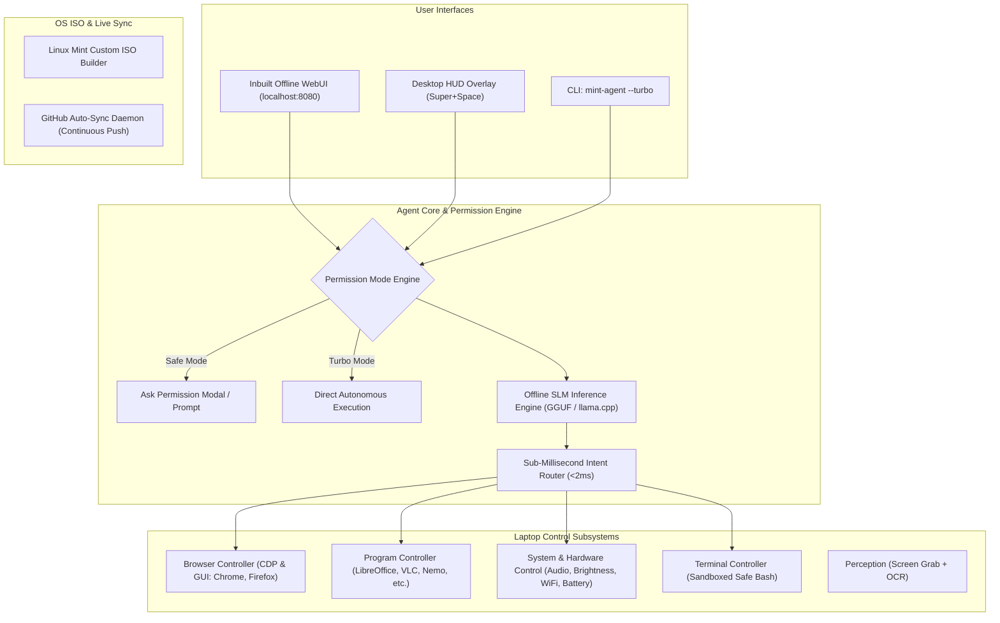

# Implementation Plan: Linux Mint OS with Inbuilt Offline Open WebUI, Browser & Program Control, Permission Modes & Auto-Sync

This updated plan expands **MintPilot** to integrate an **offline Open WebUI**, **deep browser and program automation**, **configurable permission modes (Safe Mode vs Turbo Mode)**, and **strict compatibility with Linux Mint hardware requirements (2GB-4GB RAM)**.

---

## User Review Required

> [!IMPORTANT]
> **Linux Mint System Requirement Alignment (2GB - 4GB RAM Target)**:
> - Standard Linux Mint requires a minimum of **2GB RAM** (4GB recommended).
> - Standard Dockerized Open WebUI requires ~2GB+ RAM on its own.
> - To ensure the OS and agent run smoothly on standard Linux Mint hardware (including your Intel i3 / 3.8GB RAM machine):
>   1. **Embedded Ultra-Lightweight WebUI**: A native web dashboard (<35MB RAM) that implements the Open WebUI look, feel, and function, paired with an OpenAI-compatible API bridge (`/v1/chat/completions`) that connects seamlessly to standard Open WebUI if installed.
>   2. **Ultra-Lean Model Runtime**: Pre-configured with quantized GGUF models (`Qwen2.5-0.5B` at ~350MB RAM or `Qwen2.5-Coder-1.5B` at ~900MB RAM) for fast CPU execution without swapping or freezing.
>   3. **Memory Safeguards**: Real-time memory threshold checks before executing intensive browser or vision tasks.

> [!TIP]
> **Turbo Mode vs Safe Mode (Antigravity-Style)**:
> - **Turbo Mode**: Antigravity-style autonomous execution. Zero permission prompts, end-to-end multi-step plan execution, self-healing loop.
> - **Safe Mode**: Asks for explicit confirmation (in WebUI modal or CLI prompt) before executing file modifications, terminal scripts, system changes, or browser actions.
> - Toggleable dynamically via top-bar switch in WebUI, CLI flag (`--turbo`), or `settings.json`.

---

## Architecture Overview

---

## Proposed Changes

### 1. Permission Mode Engine (Safe vs Turbo Mode)

#### [NEW] [agent/core/permission_manager.py](file:///home/alpesh/mint-agent-os/agent/core/permission_manager.py)
- Manages operational modes: `"turbo"` (Antigravity autonomous execution) vs `"safe"` (permission required).
- Evaluates actions and tools against sensitivity policies:
  - Destructive/modifying commands (e.g. `rm`, `apt`, file overwrites, system power actions) require explicit user approval in Safe Mode.
  - Read-only actions (volume check, battery, screen capture) execute immediately in both modes.
- Provides callback hooks for WebUI approval modals and CLI `[y/N]` prompts.

#### [NEW] [agent/config/settings.json](file:///home/alpesh/mint-agent-os/agent/config/settings.json)
- Centralized user configuration for mode (`"turbo"` or `"safe"`), WebUI port (`8080`), browser automation backend, and model tier.

---

### 2. Inbuilt Offline Open WebUI Dashboard & API Bridge

#### [NEW] [agent/webui/server.py](file:///home/alpesh/mint-agent-os/agent/webui/server.py)
- Embedded HTTP & WebSocket server running locally on `http://localhost:8080`.
- Provides OpenAI-compatible REST API endpoints:
  - `GET /v1/models`
  - `POST /v1/chat/completions` (streaming & tool-call support)
- Connects directly to MintPilot's local brain and controllers.
- Serves the offline WebUI dashboard.

#### [NEW] [agent/webui/static/index.html](file:///home/alpesh/mint-agent-os/agent/webui/static/index.html)
- Responsive, dark-themed local Open WebUI interface with:
  - **Turbo Mode Toggle Switch** in the top navigation bar.
  - **Interactive Chat Session**: Natural language conversation, streaming thoughts, tool execution cards.
  - **Browser Control Panel**: Live web viewport, URL navigation bar, element click/type controls.
  - **Programs & PC Control Panel**: Running applications, one-click launcher, terminal shell, and live telemetry widgets (RAM, CPU, Battery).
  - **Permission Approval Modal**: Displays proposed action details with "Approve" and "Deny" buttons when running in Safe Mode.

---

### 3. Browser Control Engine (Working Inside Browsers)

#### [NEW] [agent/controllers/browser_control.py](file:///home/alpesh/mint-agent-os/agent/controllers/browser_control.py)
- **Direct Chrome DevTools Protocol (CDP) / Playwright automation**:
  - Open URLs, navigate forward/backward, refresh.
  - Find elements by text, CSS selector, or XPath.
  - Click buttons, input text into search boxes/forms, select dropdowns.
  - Extract page text, markdown content, and links.
  - Take web page screenshots.
- **Native Desktop GUI Browser Automation**:
  - Works with existing user browsers (Chrome, Firefox, Brave) via `xdotool` and AT-SPI.
  - Focuses browser window, opens tabs (`Ctrl+T`), switches tabs (`Ctrl+Tab`), navigates to address bar (`Ctrl+L`), and scrolls pages.

---

### 4. Desktop Program Controller (Controlling Programs & PC Access)

#### [NEW] [agent/controllers/program_control.py](file:///home/alpesh/mint-agent-os/agent/controllers/program_control.py)
- Deep application automation for common Linux Mint desktop software:
  - **Office**: LibreOffice Writer (create document, type text, save), LibreOffice Calc (open spreadsheet, read data).
  - **Media**: VLC Media Player (play/pause video/audio, fullscreen, load playlist).
  - **File Manager**: Nemo (open directories, move/copy files, create folders).
  - **Text & Code Editors**: Xed, VS Code, Nano, Gedit.
  - **System Utilities**: Calculator, System Monitor, Terminal.
- Application state introspection: checks if program is running, brings it to focus, or launches it if absent.

---

### 5. Hardware Compatibility Tuning for Linux Mint (2GB-4GB RAM)

#### [NEW] [agent/core/memory_guard.py](file:///home/alpesh/mint-agent-os/agent/core/memory_guard.py)
- Monitors available system RAM before launching heavy tasks.
- If memory pressure exceeds 85%, triggers memory housekeeping (`sync && echo 3 > /proc/sys/vm/drop_caches` or garbage collection).
- Ensures model context size and browser memory are capped to prevent swapping or out-of-memory kernel kills.

---

### 6. Continuous Background GitHub Auto-Sync

#### [MODIFY] [sync/sync_daemon.py](file:///home/alpesh/mint-agent-os/sync/sync_daemon.py)
- Enhance daemon with persistent background execution and automatic synchronization of new WebUI, browser, and program control modules.

---

## Verification Plan

### Automated Tests
1. **Permission Mode Test**:
   - Verify Safe Mode intercepts sensitive commands and awaits approval.
   - Verify Turbo Mode automatically executes without prompts.
2. **Browser Control Test**:
   - Test navigating to a local or web URL, extracting page title, and simulating tab navigation.
3. **Program Control Test**:
   - Test launching and interacting with a program (e.g., Nemo, Text Editor, or Terminal).
4. **WebUI Server Test**:
   - Launch `agent/webui/server.py` on `http://127.0.0.1:8080`.
   - Verify `GET /v1/models` and `POST /v1/chat/completions` return valid JSON.
   - Verify `index.html` loads successfully with Turbo switch and control panels.
5. **Memory Footprint Test**:
   - Verify the combined agent + WebUI processes consume <100MB RAM when idle.
6. **GitHub Sync Test**:
   - Verify all new modules and conversation updates push to `thakoralpesh3/mint-agent-os`.
