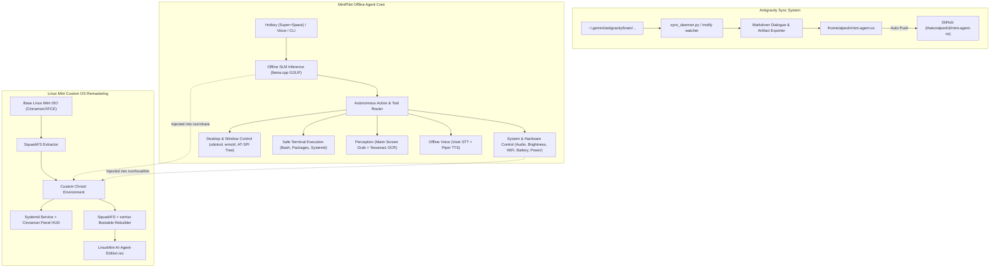

# Implementation Plan: Linux Mint OS with Inbuilt Offline Laptop Controller Agent & GitHub Auto-Sync

This project accomplishes two interconnected objectives:
1. **GitHub Repository & Continuous Conversation Sync Engine**: Completely storing this work to a new dedicated GitHub repository (`thakoralpesh3/mint-agent-os`) and establishing an automated synchronization daemon that tracks this conversation's transcripts, artifacts, and codebase in real time, auto-committing and pushing updates to GitHub.
2. **Linux Mint AI OS with Inbuilt Offline Agent**: Architecting and building **MintPilot** (an autonomous offline agent capable of total laptop control) embedded into a customized, bootable Linux Mint OS distribution and ISO remastering suite.

---

## User Review Required

> [!IMPORTANT]
> **Hardware Compatibility & Model Selection**:
> - Your current machine has an **Intel Core i3-4005U (2 cores, 1.70 GHz)** with **3.7 GB RAM** and **Intel Integrated Graphics**.
> - Running 7B+ LLMs locally on this hardware would freeze the system. Therefore, our offline agent architecture uses a **Dynamic Hardware-Adaptive Model Tier**:
>   - **Tier 1 (Ultra-Light / Low RAM - Default for 4GB RAM)**: `Qwen2.5-0.5B-Instruct` (~400MB RAM) or `Qwen2.5-Coder-1.5B-Q4_K_M` (~1.1GB RAM) using quantized GGUF via `llama.cpp` for rapid CPU inference.
>   - **Tier 2 (Balanced - for 8GB+ RAM)**: `Qwen2.5-3B` or `Llama-3.2-3B`.
>   - **Tier 3 (High-End - for 16GB+ RAM / GPU)**: `Qwen2.5-7B` or `Mistral-Nemo-12B`.
> - The OS will automatically detect the host laptop's CPU, GPU, and RAM at boot and select the optimal model tier.

> [!NOTE]
> **Target Desktop Environment for the Custom Linux Mint OS**:
> - We recommend **Linux Mint Cinnamon** (or **XFCE Edition** for ultra-lightweight performance on older laptops). The agent tools support both X11 and Cinnamon/XFCE window managers.

---

## Open Questions

1. **GitHub Repository Name**:
   - We propose `thakoralpesh3/mint-agent-os`. Let us know if you prefer a different repository name (e.g., `linuxmint-autonomous-os` or `mintpilot`).
2. **Preferred Linux Mint Edition for Base ISO**:
   - Would you prefer the remastering pipeline to target **Linux Mint 22.3 Cinnamon** (modern, feature-rich) or **Linux Mint 22.3 XFCE** (fastest, lowest RAM footprint, ideal for 4GB machines)? We can configure the builder to support either.
3. **Voice Interaction Preference**:
   - Should offline voice input (Vosk STT) and voice feedback (Piper TTS) be enabled by default, or should keyboard/HUD overlay be primary with voice as an optional toggle?

---

## Proposed Architecture

---

## Proposed Changes

### 1. GitHub Repository & Auto-Sync System

#### [NEW] [sync_daemon.py](file:///home/alpesh/mint-agent-os/sync/sync_daemon.py)
- Continuously monitors the Antigravity conversation directory (`~/.gemini/antigravity/brain/f6d7c7fb-c648-4f36-a8f0-31475c1d286c/`).
- Extracts `transcript.jsonl` and translates raw events into a human-readable `CONVERSATION.md` file with chronological turns.
- Copies artifacts (`implementation_plan.md`, `walkthrough.md`, diagrams) into `artifacts/`.
- Commits and pushes changes to GitHub whenever updates are detected or on interval.

#### [NEW] [sync_to_github.sh](file:///home/alpesh/mint-agent-os/sync_to_github.sh)
- One-click manual script to trigger immediate sync, commit, and push.

#### [NEW] [mint-agent-sync.service](file:///home/alpesh/mint-agent-os/sync/mint-agent-sync.service)
- Systemd user service to keep the auto-sync daemon running in the background.

---

### 2. MintPilot: Inbuilt Offline Autonomous Laptop Controller Agent

#### [NEW] [agent/brain/inference.py](file:///home/alpesh/mint-agent-os/agent/brain/inference.py)
- Local offline inference engine utilizing `llama.cpp` (GGUF) or `ollama`.
- Hardware-adaptive model selector: checks RAM, CPU cores, and GPU at runtime.
- Structured tool-calling parser that translates natural language intentions into concrete system actions.

#### [NEW] [agent/controllers/system_control.py](file:///home/alpesh/mint-agent-os/agent/controllers/system_control.py)
- **Audio**: volume up/down, mute/unmute via `pactl` / `amixer`.
- **Display**: screen brightness adjustment via `brightnessctl`.
- **Power & Battery**: battery percentage, charging status via `upower`, system sleep, lock screen, shutdown, reboot.
- **Networking**: Wi-Fi status, scan networks, connect to SSID, airplane mode via `nmcli`.
- **Bluetooth**: status, pairing, toggle via `bluetoothctl`.
- **Applications & Processes**: launch apps (`gio launch`, `xdg-open`), inspect running processes, kill unresponsive apps.

#### [NEW] [agent/controllers/gui_control.py](file:///home/alpesh/mint-agent-os/agent/controllers/gui_control.py)
- **Window Management**: list windows, focus/switch window, minimize, maximize, tile via `wmctrl`.
- **Mouse & Keyboard**: move cursor, click, drag, double-click, type text, key combinations (`Ctrl+C`, `Alt+Tab`, `Super+D`) via `xdotool` / `pyautogui`.
- **Accessibility Inspection**: uses Linux AT-SPI to inspect UI element hierarchies (buttons, inputs, menus) natively without requiring heavy vision models.

#### [NEW] [agent/controllers/terminal_control.py](file:///home/alpesh/mint-agent-os/agent/controllers/terminal_control.py)
- Sandboxed and controlled bash command execution.
- Captures stdout/stderr and feeds output back into the agent reasoning loop for self-correction.
- Safety filter protecting critical files and prompting confirmation for destructive commands.

#### [NEW] [agent/controllers/screen_vision.py](file:///home/alpesh/mint-agent-os/agent/controllers/screen_vision.py)
- Lightweight screen capture (`maim`/`scrot`) + OCR (`pytesseract`) to allow the agent to read on-screen text and find coordinates of buttons/icons.

#### [NEW] [agent/controllers/voice_engine.py](file:///home/alpesh/mint-agent-os/agent/controllers/voice_engine.py)
- Offline Speech-to-Text via `vosk` (runs on CPU with ~50MB RAM).
- Offline Text-to-Speech via `piper-tts` or `espeak-ng`.

#### [NEW] [agent/ui/hud_overlay.py](file:///home/alpesh/mint-agent-os/agent/ui/hud_overlay.py)
- Translucent floating HUD command bar (Python GTK3 / PyQt5) that pops up on global hotkey (`Super + Space`).
- Displays live agent thoughts, tool execution status, and quick response pill.

#### [NEW] [agent/ui/tray_applet.py](file:///home/alpesh/mint-agent-os/agent/ui/tray_applet.py)
- Linux Mint panel tray indicator showing agent status (Idle, Thinking, Controlling), model info, and quick actions.

#### [NEW] [agent/cli.py](file:///home/alpesh/mint-agent-os/agent/cli.py)
- Direct terminal interface (`mint-agent "set brightness to 50% and open firefox"`).

---

### 3. Linux Mint OS Custom Remastering & ISO Builder

#### [NEW] [iso_builder/download_mint_iso.sh](file:///home/alpesh/mint-agent-os/iso_builder/download_mint_iso.sh)
- Verifies and downloads the official Linux Mint 22.3 ISO (Cinnamon or XFCE) with SHA256 checksum verification.

#### [NEW] [iso_builder/remaster_mint_iso.sh](file:///home/alpesh/mint-agent-os/iso_builder/remaster_mint_iso.sh)
- Automated rootfs extraction (`unsquashfs`).
- Chroot provisioning:
  - Installs runtime dependencies (`xdotool`, `wmctrl`, `brightnessctl`, `tesseract-ocr`, `pactl`, `python3-pip`, `python3-gi`, etc.).
  - Installs MintPilot agent into `/opt/mint-agent/` and links `/usr/local/bin/mint-agent`.
  - Bundles offline GGUF model weights into `/usr/share/mint-agent/models/`.
  - Configures systemd service `/etc/systemd/system/mint-agent.service`.
  - Configures XDG Autostart and desktop keybindings (`Super+Space` to trigger HUD).
  - Configures branded wallpaper, themes, and welcome screen.
- SquashFS re-packing (`mksquashfs`).
- Hybrid bootable ISO generation via `xorriso` with EFI and legacy BIOS boot support.

#### [NEW] [iso_builder/test_qemu.sh](file:///home/alpesh/mint-agent-os/iso_builder/test_qemu.sh)
- Instant test launcher to boot the customized ISO in a QEMU virtual machine.

---

## Verification Plan

### Automated Tests
1. **GitHub Sync Test**:
   - Verify `gh auth status` and create `thakoralpesh3/mint-agent-os`.
   - Run `sync_daemon.py` in one-shot mode: verify conversation logs and artifacts appear on GitHub.
   - Verify auto-push succeeds without errors.
2. **Laptop Control Unit Tests**:
   - Test `system_control.py`: test volume query, battery query, Wi-Fi scan, brightness check.
   - Test `gui_control.py`: test window listing (`wmctrl -l`), cursor position query, AT-SPI accessibility tree test.
   - Test `inference.py`: run prompt against local engine (e.g. "turn down volume to 20%") and verify tool output JSON.
3. **ISO Remastering Dry-Run**:
   - Test toolchain availability (`mksquashfs`, `unsquashfs`, `xorriso`).
   - Validate chroot build script syntax and configuration files.

### Manual Verification
- Trigger global hotkey `Super+Space` (or run CLI `mint-agent`) to issue laptop control commands.
- Verify live commits appear on GitHub repository `https://github.com/thakoralpesh3/mint-agent-os`.
