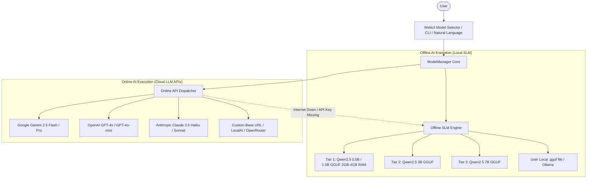

# Implementation Plan: In-Place Linux Mint OS Updater & Offline/Online AI Model Switcher

This plan delivers two major capabilities for **MintPilot on Linux Mint**:
1. **OS Upgrade & Updater Option**: Enables users running standard Linux Mint (21.x / 22.x) to transform their OS into MintPilot Agent OS with a 1-line script or in-place CLI/WebUI update.
2. **Offline & Online AI Model Customization**: Empowers users to customize, select, and switch between offline local SLMs (Qwen2.5 0.5B, 1.5B, 3B, 7B, local GGUF) and online cloud models (Google Gemini 2.5, OpenAI GPT-4o, Anthropic Claude, custom endpoints) via WebUI, CLI, and natural language.

---

## Architecture Overview

---

## Proposed Changes

### 1. AI Model Management Engine (`agent/brain/model_manager.py`)
#### [NEW] [model_manager.py](file:///home/alpesh/mint-agent-os/agent/brain/model_manager.py)
- Manages model catalog (Offline: 0.5B, 1.5B, 3B, 7B, GGUF paths; Online: Gemini 2.5, GPT-4o, Claude 3.5, Custom URLs).
- Handles API keys in `~/.config/mint-agent/keys.json` with env var fallbacks.
- Dispatches inference requests with automatic offline fallback if internet or API keys fail.
- Exposes `list_models()`, `set_model()`, `set_api_key()`, `generate()`.

### 2. Integration into Brain Inference (`agent/brain/inference.py`)
#### [MODIFY] [inference.py](file:///home/alpesh/mint-agent-os/agent/brain/inference.py)
- Connects `ModelManager` to `AgentBrain`.
- Fast intent matching for:
  - "list models", "show models"
  - "switch model to X", "change ai to X", "use gemini", "use gpt-4o", "use offline qwen"
  - "update os", "check update"

### 3. CLI Command Options (`agent/cli.py`)
#### [MODIFY] [cli.py](file:///home/alpesh/mint-agent-os/agent/cli.py)
- `--list-models`: Displays table of offline and online models with active model highlight.
- `--set-model <MODEL_ID>`: Sets active model (e.g. `mint-agent --set-model gemini-2.5-flash`).
- `--set-key <PROVIDER> <KEY>`: Saves API key.
- `--update-os`: In-place upgrade of MintPilot Agent OS.
- `--check-update`: Checks upstream GitHub repo for updates.

### 4. WebUI Endpoints & Interface (`agent/webui/server.py` & `agent/webui/static/index.html`)
#### [MODIFY] [server.py](file:///home/alpesh/mint-agent-os/agent/webui/server.py)
- `GET /api/models`: Returns list of offline and online models, active selection.
- `POST /api/set_model`: Switches active model and provider.
- `GET /api/check_update`: Checks for OS updates.
- `POST /api/update_os`: Triggers in-place OS update.

#### [MODIFY] [index.html](file:///home/alpesh/mint-agent-os/agent/webui/static/index.html)
- Add **AI Model Selector Dropdown & Modal**:
  - Offline tab: Quick switch between 0.5B, 1.5B, 3B, 7B, or custom GGUF path.
  - Online tab: Select Gemini, OpenAI, Claude, enter API keys, test connection.
- Add **Update Agent OS** button with live status modal.

### 5. 24/7 Simulator & Documentation (`docs/` & `README.md`)
#### [MODIFY] [docs/index.html](file:///home/alpesh/mint-agent-os/docs/index.html) & [docs/js/agent_simulator.js](file:///home/alpesh/mint-agent-os/docs/js/agent_simulator.js)
- Add AI model selector badge and switcher modal in the online simulator.
- Simulate `--list-models`, `--set-model`, and `--update-os` in terminal.
- Add "Upgrade Existing Linux Mint" quick modal with copyable 1-line command.

#### [MODIFY] [README.md](file:///home/alpesh/mint-agent-os/README.md)
- Document:
  1. How to Upgrade an Existing Linux Mint OS into MintPilot Agent OS.
  2. How Users Can Change AI Models (Offline & Online).

---

## Verification Plan

### Automated & Manual Verification
1. **Model Manager Unit Test**:
   - Test offline model switching (`qwen2.5-0.5b`, `qwen2.5-1.5b`).
   - Test online model configuration (`gemini-2.5-flash`, `gpt-4o-mini`).
   - Test automatic offline fallback when online API key is missing.
2. **CLI Flags Verification**:
   - `python3 /home/alpesh/mint-agent-os/agent/cli.py --list-models`
   - `python3 /home/alpesh/mint-agent-os/agent/cli.py --set-model qwen2.5-1.5b`
   - `python3 /home/alpesh/mint-agent-os/agent/cli.py --check-update`
3. **WebUI API Verification**:
   - Test `GET /api/models` and `POST /api/set_model`.
   - Test `GET /api/check_update` and `POST /api/update_os`.
4. **Git Sync**:
   - Verify all changes are pushed and live on GitHub Pages.
