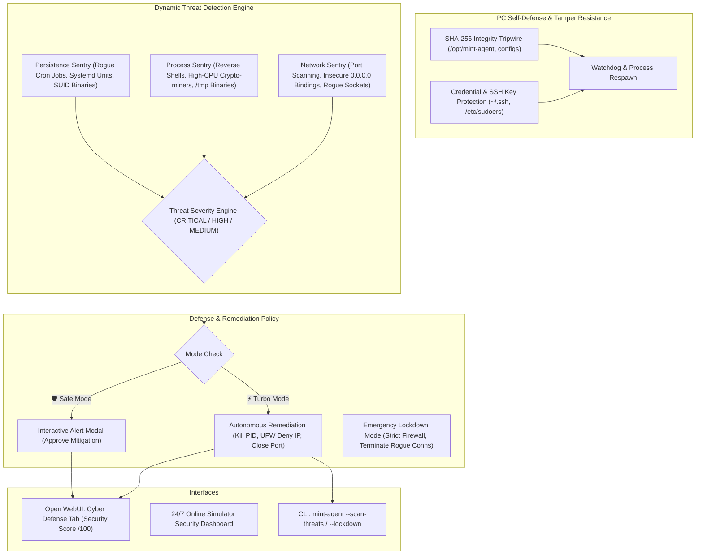

# Implementation Plan: Autonomous PC Self-Defense & Dynamic Threat Protection Guardian for Linux Mint OS

This plan details the implementation of an autonomous **Cybersecurity Guardian & PC Defense System** embedded directly into **MintPilot** on Linux Mint, enabling the agent to protect the computer, defend itself against tampering, detect cyber threats dynamically, and execute defensive mitigations autonomously.

---

## User Review Required

> [!IMPORTANT]
> **Dynamic Threat Remediation in Turbo Mode vs Safe Mode**:
> - **⚡ Turbo Mode (Autonomous Cyber Defense)**:
>   - When a critical threat is detected (e.g., suspicious reverse shell, rogue miner in `/tmp`, unauthorized inbound connection, or port scan), MintPilot **neutralizes the threat immediately** (terminates malicious process, blocks IP via UFW firewall, isolates port) and logs the action without interrupting the user.
> - **🛡️ Safe Mode (Guarded Alerting)**:
>   - MintPilot generates an immediate desktop alert and Open WebUI modal showing Threat Severity, attack vector, and a 1-click **"Approve Neutralization"** button before taking defensive action.
> - **Self-Defense Architecture**:
>   - MintPilot protects its own systemd services, binaries, GGUF models, and configuration files using cryptographic SHA-256 tripwires and inotify watchdog monitoring.

---

## Architecture Overview

---

## Proposed Changes

### 1. Security Guardian & PC Self-Defense Engine

#### [NEW] [agent/security/self_defense.py](file:///home/alpesh/mint-agent-os/agent/security/self_defense.py)
- Protects MintPilot itself:
  - Generates and verifies SHA-256 checksums of core binaries, config files, and systemd services.
  - Monitors and verifies `/etc/sudoers.d/`, polkit rules, and SSH authorized keys against tampering.
  - Automatic self-healing: restores corrupted or tampered configs from internal verified backups.

#### [NEW] [agent/security/threat_detector.py](file:///home/alpesh/mint-agent-os/agent/security/threat_detector.py)
- Real-time threat detection:
  - **Insecure Bindings**: Scans `ss -tulpn` for unauthenticated services listening on `0.0.0.0` instead of `127.0.0.1`.
  - **Rogue Processes**: Flags processes executing from `/tmp`, `/dev/shm`, hidden reverse shells (`nc -e`, `bash -i >& /dev/tcp`), and abnormal CPU spikes.
  - **Unauthorized Persistence**: Scans cron directories (`/etc/cron.*`, `/var/spool/cron/crontabs`), new systemd units, and rogue SUID binaries (`find / -perm -4000`).
  - **Brute-Force & Network Intrusions**: Detects connection floods and unauthorized external SSH/RDP/HTTP attempts.

#### [NEW] [agent/security/remediation.py](file:///home/alpesh/mint-agent-os/agent/security/remediation.py)
- Autonomous defensive remediation:
  - `block_ip(ip_address)`: Configures UFW/iptables to immediately drop traffic from hostile IP.
  - `terminate_threat(pid)`: Force-kills malicious process and removes malicious file executable bit.
  - `lockdown_system()`: Enables strict UFW firewall (`default deny incoming`, `default allow outgoing`), closes exposed test ports, and restricts sensitive directory permissions.
  - `calculate_security_score()`: Computes an overall Cyber Hardening Score (0-100) based on CIS benchmarks and active posture.

---

### 2. Integration with Agent Brain & Controllers

#### [MODIFY] [agent/brain/inference.py](file:///home/alpesh/mint-agent-os/agent/brain/inference.py)
- Integrate `SecurityGuardian`:
  - Natural language commands: `"scan for threats"`, `"security status"`, `"lockdown pc"`, `"block ip <ip>"`, `"harden firewall"`.
  - Background periodic security heartbeat monitoring.

#### [MODIFY] [agent/cli.py](file:///home/alpesh/mint-agent-os/agent/cli.py)
- Add security CLI flags:
  - `mint-agent --security` (Displays security posture score, open ports, and threats)
  - `mint-agent --scan-threats` (Performs deep system and network threat audit)
  - `mint-agent --lockdown` (Activates strict autonomous lockdown)

---

### 3. Open WebUI & Online 24/7 Simulator Integration

#### [MODIFY] [agent/webui/static/index.html](file:///home/alpesh/mint-agent-os/agent/webui/static/index.html)
- Add new **🛡️ Cyber Defense Tab**:
  - Live Security Health Score widget (e.g. `96/100 Hardened`).
  - Active Firewall Status & Network Exposure map.
  - Threat detection feed with 1-click "Neutralize" / "Block IP" buttons.
  - "Lockdown PC" emergency defense switch.

#### [MODIFY] [docs/index.html](file:///home/alpesh/mint-agent-os/docs/index.html) & [docs/js/agent_simulator.js](file:///home/alpesh/mint-agent-os/docs/js/agent_simulator.js)
- Update 24/7 online simulator with the Cyber Defense Guardian app and terminal security commands.

---

## Verification Plan

### Automated Tests
1. **Threat Scanner Test**:
   - Run threat detection scan; verify detection of listening ports on `0.0.0.0` vs `127.0.0.1`.
   - Verify calculation of Security Health Score (0-100).
2. **Remediation & Self-Defense Test**:
   - Test self-defense SHA-256 verification of `/opt/mint-agent`.
   - Test UFW status query and firewall rule verification.
   - Verify Turbo Mode auto-neutralization vs Safe Mode confirmation prompting.
3. **WebUI & Simulator Test**:
   - Test `/api/security` endpoint response.
   - Verify Cyber Defense tab rendering in local WebUI and 24/7 online simulator.
4. **GitHub Auto-Sync**:
   - Verify automatic push of all security modules to `thakoralpesh3/mint-agent-os`.
