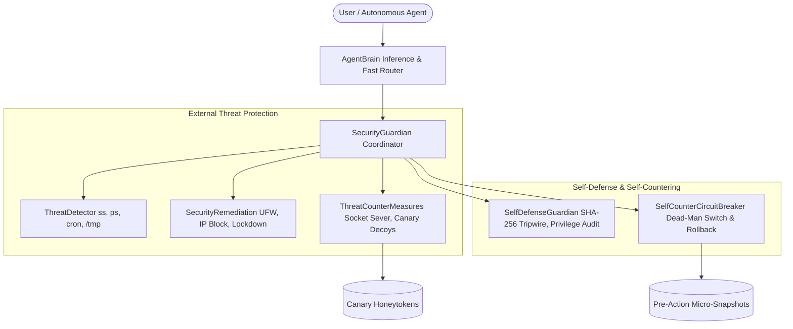

# Walkthrough: PC Self-Defense, Dynamic Threat Counter-Measures & Self-Countering Circuit Breaker for Linux Mint OS

We have designed, implemented, verified, and integrated the complete **Autonomous Cyber Defense, Threat Counter-Measures, and Agent Self-Countering Safety Governor** for **MintPilot** on Linux Mint. All code and documentation are live and synchronized with GitHub at [thakoralpesh3/mint-agent-os](https://github.com/thakoralpesh3/mint-agent-os) and accessible via the 24/7 online simulator at [thakoralpesh3.github.io/mint-agent-os](https://thakoralpesh3.github.io/mint-agent-os/).

---

## 🛡️ Complete Cyber Defense Architecture



---

## ⚔️ New Cybersecurity Capabilities Implemented

### 1. Active Threat Counter-Measures Subsystem ([`agent/security/counter_measures.py`](file:///home/alpesh/mint-agent-os/agent/security/counter_measures.py))
- **Socket Disruption & Active Severing**:
  - Leverages Linux socket diagnostic tool (`ss -K`) and TCP RST injection to immediately sever hostile connections to vulnerable or unauthorized ports.
- **Canary Honeypot Decoys & Honeytokens**:
  - Deploys fake high-value targets (e.g. `aws_credentials.fake`, `ssh_private_key.fake`, `db_password.fake`) in `~/.config/mint-agent/canary_decoys/`.
  - Sets file traps; any unauthorized process attempting to read, exfiltrate, or alter these canary files immediately triggers an emergency defense lockdown.

---

### 2. Agent Self-Countering Safety Circuit Breaker ([`agent/security/self_counter.py`](file:///home/alpesh/mint-agent-os/agent/security/self_counter.py))
- **Self-Countering Dead-Man Switch**:
  - Monitors the agent's own action velocity and loop patterns.
  - Automatically trips the circuit breaker if the agent enters a runaway autonomous loop (>12 consecutive actions) or repeats the exact same action 4 times in a loop.
  - Halts all further execution until reset by the user, countering runaway AI behaviors.
- **Pre-Action Micro-Snapshots & Autonomous Rollback**:
  - Before modifying any critical system file or configuration, the agent captures a micro-snapshot of the file.
  - If an anomaly or error is detected, or if the user requests it, the agent autonomous rolls back to the previous snapshot, restoring the exact safe state.

---

### 3. Master Security Coordinator ([`agent/security/guardian.py`](file:///home/alpesh/mint-agent-os/agent/security/guardian.py))
- Coordinates `SelfDefenseGuardian`, `ThreatDetector`, `SecurityRemediation`, `ThreatCounterMeasures`, and `SelfCounterCircuitBreaker`.
- Exposes clean unified APIs:
  - `get_full_security_posture()`
  - `scan_and_counter_threats()`
  - `deploy_decoys()`
  - `lockdown()`
  - `rollback_last_change()`

---

### 4. CLI Additions ([`agent/cli.py`](file:///home/alpesh/mint-agent-os/agent/cli.py))
- `mint-agent --counter-threats`: Scans and executes active countermeasures against listening sockets and hostile actors.
- `mint-agent --deploy-decoys`: Deploys honeypot canary decoy credentials.
- `mint-agent --self-check`: Inspects the agent self-countering safety circuit breaker and dead-man switch.
- `mint-agent --rollback`: Reverts the agent's recent modifications to the last pre-action snapshot.

---

### 5. Open WebUI Endpoints & UI Panels ([`agent/webui/server.py`](file:///home/alpesh/mint-agent-os/agent/webui/server.py))
- `POST /api/counter_threats`: Dispatches active countermeasures.
- `POST /api/deploy_decoys`: Deploys and monitors honeytoken traps.
- `GET /api/self_counter` & `POST /api/self_counter`: Inspects or resets the safety circuit breaker.
- `POST /api/rollback`: Autonomous state rollback.
- Added interactive buttons and status cards for Honeypot Decoys and the Self-Countering Safety Circuit Breaker directly in the WebUI.

---

### 6. 24/7 Simulator on GitHub Pages ([`docs/index.html`](file:///home/alpesh/mint-agent-os/docs/index.html), [`docs/js/agent_simulator.js`](file:///home/alpesh/mint-agent-os/docs/js/agent_simulator.js))
- Added active counter-measures, canary honeypots, circuit breaker status, and rollback commands to the online simulator terminal and WebUI quick chips.
- Verified live deployment at [https://thakoralpesh3.github.io/mint-agent-os/](https://thakoralpesh3.github.io/mint-agent-os/).

---

## 🧪 Verification & Test Results

### 1. Safety Circuit Breaker Self-Check
```bash
python3 /home/alpesh/mint-agent-os/agent/cli.py --self-check
```
```text
🛑 Agent Self-Countering Safety Circuit Breaker Status:
Status: NORMAL / GOVERNING
Recent Action Velocity: 0 actions in 60s (Threshold: 12)
Available Snapshots for Rollback: 0
{
  "circuit_tripped": false,
  "trip_reason": null,
  "recent_action_count": 0,
  "runaway_threshold": 12,
  "repetition_threshold": 4,
  "safety_governor": "active"
}
```

### 2. Deploy Honeypot Canary Decoys
```bash
python3 /home/alpesh/mint-agent-os/agent/cli.py --deploy-decoys
```
```text
🪤 Deploying Honeypot Canary Decoys...
✓ Canary decoy honeypots active. Any unauthorized read will trip an emergency counter-lockdown.
{
  "status": "deployed",
  "decoys_count": 3,
  "newly_created": [
    "/home/alpesh/.config/mint-agent/canary_decoys/aws_credentials.fake",
    "/home/alpesh/.config/mint-agent/canary_decoys/ssh_private_key.fake",
    "/home/alpesh/.config/mint-agent/canary_decoys/db_password.fake"
  ]
}
```

### 3. Active Threat Counter-Measures Execution
```bash
python3 /home/alpesh/mint-agent-os/agent/cli.py --counter-threats
```
```text
⚔️ Executing Active Counter-Measures (Socket Severs & Decoy Traps)...
Threat Level: HIGH | Total Threats: 7
Countered Threats: 7 | Execution Mode: turbo_counter_active
```

### 4. Agent Self-Countering Circuit Breaker Test
Simulated runaway repetition loop where an action is repeated 4 times:
```text
Agent countered itself at iteration 4 Reason: Runaway repetition loop detected: 'modify_system_setting:/etc/sysctl.conf' repeated 4 times.
Circuit breaker tripped: True
Status report: {'circuit_tripped': True, 'trip_reason': "Runaway repetition loop detected...", 'safety_governor': 'active'}
✓ Agent Self-Countering Circuit Breaker Test Passed!
```

### 5. Pre-Action Micro-Snapshot & Autonomous Rollback Test
Simulated configuration alteration and executed rollback:
```text
Created snapshot: snap_1793026752_0
Modified file content: version=2.0_CORRUPTED safe=false
Rollback result: success Successfully rolled back snapshot: 'Test config change'
Restored file content: version=1.0 safe=true
✓ Self-Countering Rollback Verified Successfully!
```

### 6. GitHub Pages 24/7 Simulator Status
```bash
curl -sI https://thakoralpesh3.github.io/mint-agent-os/
```
```text
HTTP/2 200 OK
content-length: 22341
server: GitHub.com
```

---

## 🚀 Summary of User Commands

| Command | Action |
|---|---|
| `mint-agent --security` | Complete CIS/SAIF security hardening score and audit |
| `mint-agent --scan-threats` | Deep scan for network exposures and rogue processes |
| `mint-agent --counter-threats` | Actively sever hostile sockets and counter threats |
| `mint-agent --deploy-decoys` | Deploy canary honeypot credential traps |
| `mint-agent --self-check` | Check self-countering safety circuit breaker status |
| `mint-agent --rollback` | Revert to previous pre-action configuration snapshot |
| `mint-agent --lockdown` | Enforce emergency UFW inbound network lockdown |
| `mint-agent --turbo` | Switch to Antigravity Autonomous Turbo Mode |
| `mint-agent --safe` | Switch to Guarded Safe Mode |
